# Finlio

Finlio adds up everything a person in India owns and owes, and explains in
plain language what changed and why. Stocks, bank balances, fixed deposits,
EPF, PPF, NPS, gold, property and loans sit on one balance sheet, counted in
lakhs and crores across the April–March financial year. Its chat, built on
Google's Gemini, answers questions about that money in six languages. It
explains. It never tells anyone what to buy, sell or hold.

[finlio.app](https://finlio.app) · Next.js 16 on Cloud Run · Gemini 3.5 Flash-Lite · Firestore · Firebase Auth · Private source

| If you want to… | Start here |
|---|---|
| Understand the whole system on one page | [System context](#1-system-context) |
| See what runs where in Google Cloud | [Deployment architecture](#2-deployment-architecture) |
| Follow one request from the domain to the database | [Request lifecycle](#4-request-lifecycle) |
| See how the AI is designed, bounded and kept from giving advice | [AI architecture](#5-ai-architecture) |
| Know exactly where money data is stored and who can read it | [Data architecture](#7-data-architecture) |
| Run Finlio on your machine in five minutes | [Run it locally](#run-it-locally) |
| Ship a release | [Deploy](#deploy) |

## Contents

1. [System context](#1-system-context)
2. [Deployment architecture](#2-deployment-architecture)
3. [Application architecture](#3-application-architecture)
4. [Request lifecycle](#4-request-lifecycle)
5. [AI architecture](#5-ai-architecture)
6. [Identity and sessions](#6-identity-and-sessions)
7. [Data architecture](#7-data-architecture)
8. [Market data](#8-market-data)
9. [Security architecture](#9-security-architecture)
10. [Delivery pipeline](#10-delivery-pipeline)
11. [Quality attributes](#11-quality-attributes)

Then: [Built for India](#built-for-how-money-is-held-in-india) ·
[Measurements](#what-the-numbers-show) · [Run it locally](#run-it-locally) ·
[Deploy](#deploy) · [Operations](#operations) ·
[Repository map](#repository-map) · [Development](#development)

## Architecture decisions

| Decision | Why |
|---|---|
| **One Next.js application** for pages and APIs | One codebase, one deployable, one security boundary. Every API sits next to the screen that uses it. |
| **Cloud Run in Mumbai** (`asia-south1`) | Close to the people it serves and to the database; scales to zero; each deploy is a revision that can be rolled back instantly. |
| **Firebase Hosting in front** | Free managed certificate and custom domain for a region where Cloud Run domain mapping is not offered. |
| **Server-side encryption** of every money record | A copy of the database alone reveals nothing, while the server can still show people their own numbers and support multiple devices. |
| **The model sees totals, never records** | The cheapest data to protect is data never sent. The app does the arithmetic; the model only explains it. |
| **A small model** (Gemini 3.5 Flash-Lite) | Explaining numbers the app has already calculated needs fluency, not deep reasoning. Low latency, low cost per answer. |
| **Explain, never advise** as an enforced rule | Enforced twice: by the prompt and by a filter that checks every sentence before anyone sees it. |

## 1. System context

Who and what Finlio talks to. The browser talks only to Finlio and to
Firebase Auth; everything else is reached by Finlio's server.

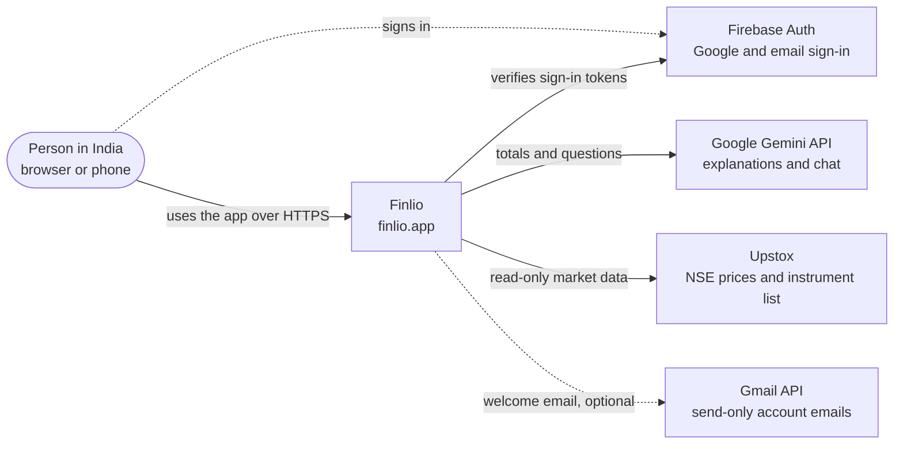

| External system | What Finlio uses it for | What Finlio sends |
|---|---|---|
| Firebase Auth | Account sign-in with Google or email and password | Nothing; the browser signs in and Finlio verifies the resulting token |
| Gemini API | Chat answers and Analytics summaries | Totals, percentages, the question and recent turns, never raw records |
| Upstox | Live NSE prices and the list of NSE equities | Instrument keys only |
| Gmail API | A welcome email from a send-only account, when configured | The recipient's address and name |

## 2. Deployment architecture

Everything runs in one Google Cloud project, in Mumbai where a region applies.

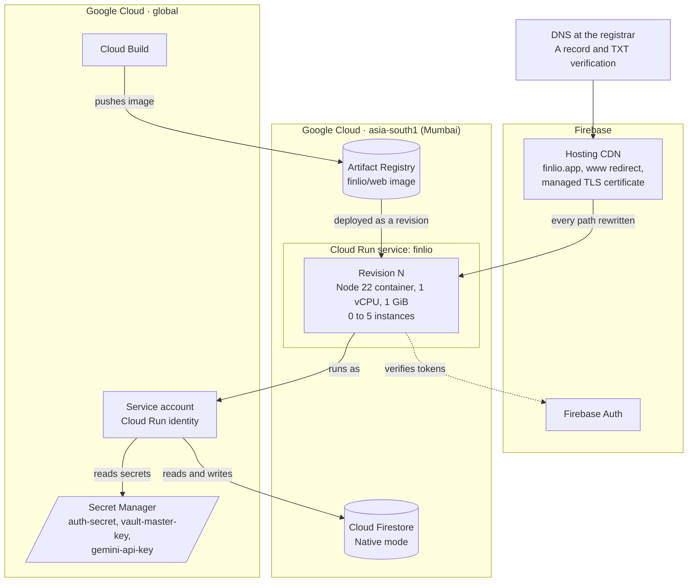

| Resource | Setting |
|---|---|
| Cloud Run service | `finlio`, `asia-south1`, public, port 8080, 1 vCPU, 1 GiB, scales 0–5 |
| Container | Node 22 on Alpine, multi-stage build, runs as an unprivileged user |
| Database | Firestore Native mode, `(default)` database, `asia-south1` |
| Secrets | Three secrets in Secret Manager, mounted as environment variables at revision start |
| Identity | Cloud Run's service account reaches Firestore and Secret Manager; no key files anywhere |
| Edge | Firebase Hosting site rewrites `**` to the Cloud Run service; `www.finlio.app` redirects permanently to `finlio.app` |
| Images | Artifact Registry repository `finlio` in `asia-south1` |

## 3. Application architecture

Inside the one application: what runs in the browser, what runs on the server,
and the modules each depends on.

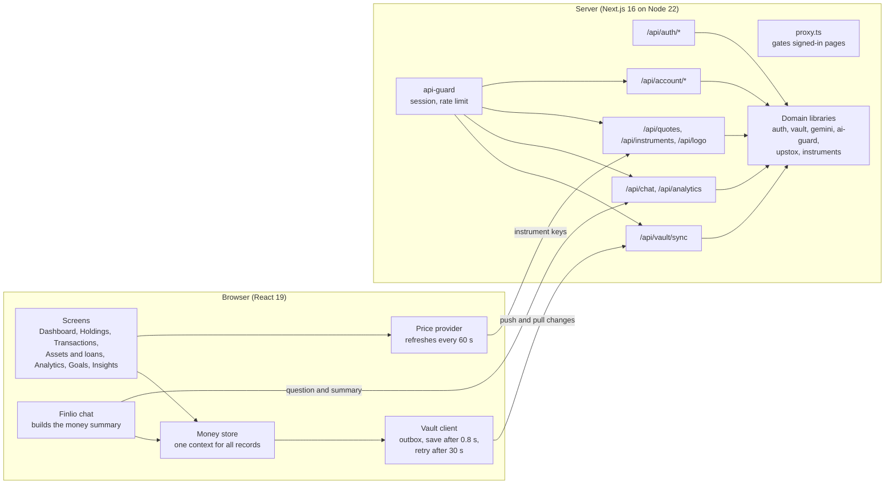

| Server route | Purpose | Limit per minute |
|---|---|---|
| `POST /api/auth/firebase` | Exchange a Firebase ID token for a Finlio session | 10 per address, same-site only |
| `GET /api/auth/session`, `POST /api/auth/logout` | Read or end the session | none / session |
| `GET, POST /api/vault/sync` | Pull changes after a revision, push changes | 120 each, per person |
| `POST /api/chat` | Streamed chat answer | 20 per person |
| `POST /api/analytics` | Four to six bullet points about the Analytics screen | 5 per person |
| `POST /api/quotes` | Live prices for up to 50 instruments | 60 per person |
| `GET /api/instruments` | Search NSE equities | 300 per person |
| `GET /api/logo` | Company logo from an allow-list of domains | 300 per person |
| `POST /api/account/profile`, `POST /api/account/delete` | Update the profile, delete the account and its data | 20 and 3 per person |

The client is built from Base UI primitives, Tailwind CSS 4, Motion and
Lucide icons, in Geist Sans and Geist Mono. The interface is translated into
six languages in [lib/i18n](lib/i18n).

## 4. Request lifecycle

One authenticated API call, from the domain to the database and back.

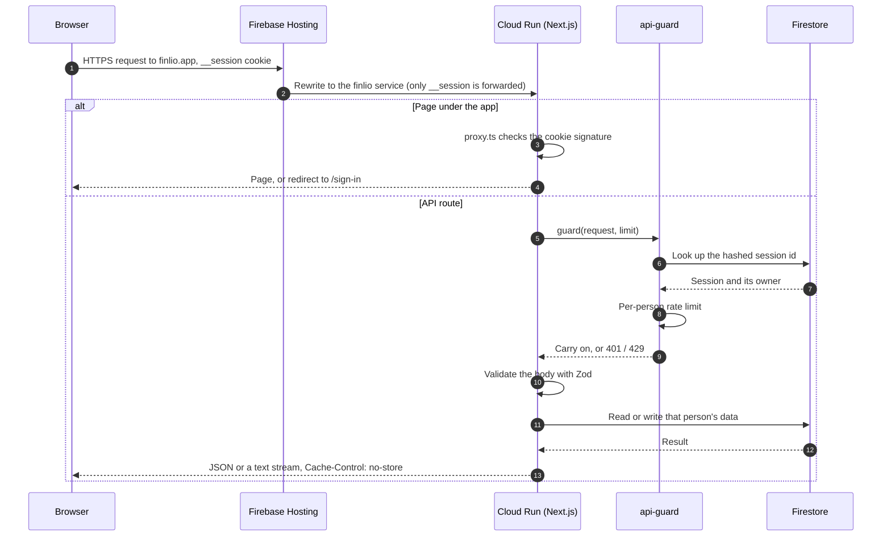

Pages are gated by a signature check only, which needs no database call. Every
API route checks the session in Firestore before touching data, so signing out
or deleting an account takes effect on the next request.

## 5. AI architecture

Finlio uses AI for two jobs: answering questions in the chat, and writing a
few sentences that explain the Analytics screen. Both follow the same four
principles.

| Principle | How it is enforced |
|---|---|
| **Explain, never advise.** | A system prompt with explicit rules and a worked refusal, plus a sentence-level filter on everything the model writes |
| **Send the model as little as possible.** | The browser reduces full records to totals and percentages; the server's schema rejects anything else |
| **Treat data as data.** | The person's numbers go to the model inside a marked `<money_summary>` block that the prompt says never to obey |
| **Bound the cost of every call.** | A small model, low temperature, minimal thinking, a hard output cap and per-person rate limits |

### 5.1 The AI pipeline

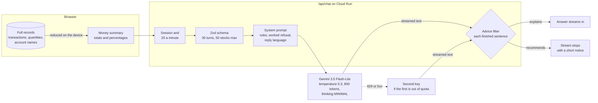

### 5.2 How a chat question is answered

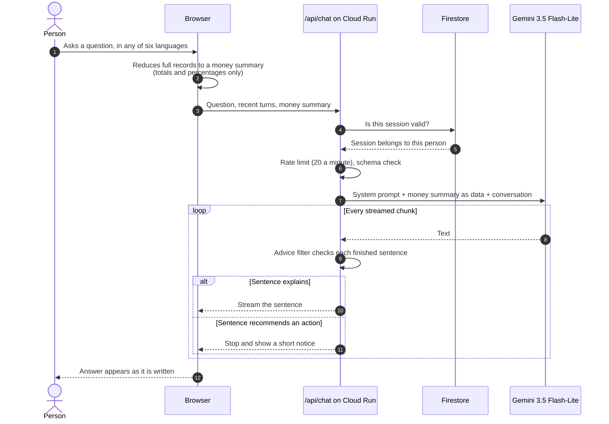

### 5.3 The two AI features

| | Chat | Analytics summary |
|---|---|---|
| Route | [app/api/chat/route.ts](app/api/chat/route.ts) | [app/api/analytics/route.ts](app/api/analytics/route.ts) |
| Input | Up to 30 turns, plus totals, category spending, allocation, each stock's daily and overall percentage change, an optional news brief and goal | Net worth, assets, loans, period totals, previous period's spending, category spending, allocation |
| Never sent | Transactions, merchants, account numbers, share quantities | Same |
| Output | Streamed text, under 120 words by default; greetings get one short line | Four to six one-sentence bullet points |
| Guardrails | Prompt rules, data block, streaming sentence filter | Prompt rules, filter on every bullet |
| Limit | 20 requests a minute per person | 5 requests a minute per person |

### 5.4 Guardrails in depth

1. **The prompt** ([lib/chat-prompt.ts](lib/chat-prompt.ts)) forbids
   recommending any action with money, naming or ranking a product,
   predicting prices, and inventing numbers or reasons. It shows the model how
   to decline: say Finlio explains rather than advises, explain the person's
   own numbers instead, and point to a SEBI-registered investment adviser.
   Greetings get one short line, and the chat says it runs on Gemini if asked.
2. **The data boundary.** The person's figures arrive inside
   `<money_summary>` tags and are declared to be data, so a news headline or
   a goal that reads like an instruction is not followed.
3. **The advice filter** ([lib/ai-guard.ts](lib/ai-guard.ts)) reads the reply
   one sentence at a time in English, Hindi, Tamil, Telugu, Kannada and
   Marathi. If a sentence recommends an action, the stream stops there and
   the person sees a short notice instead. Refusals such as "I can't tell you
   which share to buy" pass through, because they are recognised as refusals.
4. **Tests.** [tests/chat-prompt.test.ts](tests/chat-prompt.test.ts) and
   [tests/ai-guard.test.ts](tests/ai-guard.test.ts) pin the rules and check
   that the prompt's own example refusal passes the filter.

### 5.5 Model choice and cost controls

| Control | Setting | Where |
|---|---|---|
| Model | `gemini-3.5-flash-lite`, overridable with `GEMINI_MODEL` | [lib/gemini.ts](lib/gemini.ts) |
| Sampling | Temperature 0.3 | [app/api/chat/route.ts](app/api/chat/route.ts) |
| Reasoning | Thinking level `MINIMAL` | same |
| Length | At most 800 output tokens per reply | same |
| Availability | A second key (`GEMINI_API_KEY_2`) answers when the first is out of quota or failing | [lib/gemini.ts](lib/gemini.ts) |
| Abuse | Per-person request limits on every AI route | [lib/api-guard.ts](lib/api-guard.ts) |

Flash-Lite is enough because every answer is an explanation of numbers the
app has already calculated. The model never does the arithmetic that the
balance sheet depends on.

## 6. Identity and sessions

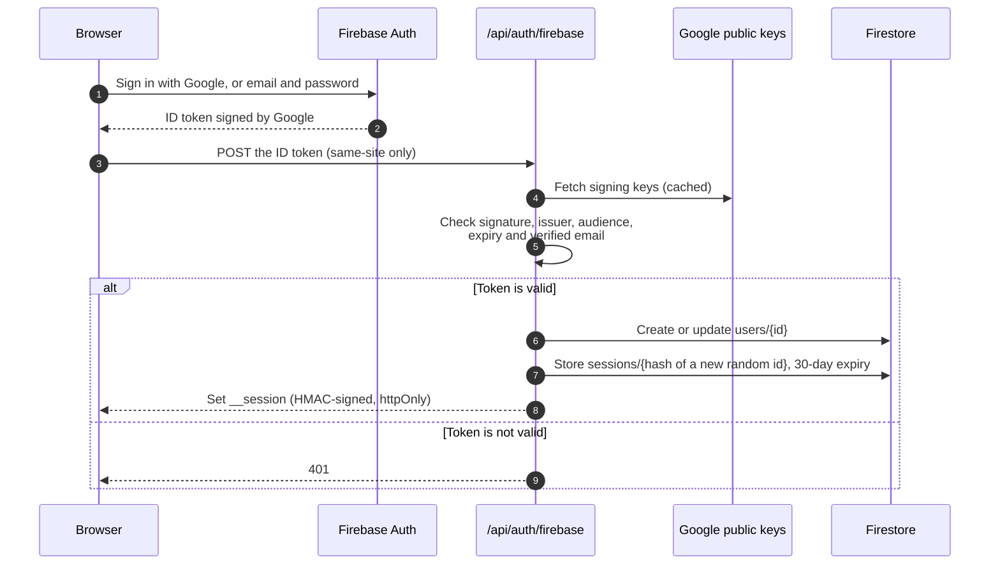

- ID tokens are verified against Google's published keys, the project's
  issuer and audience. Email sign-ups must verify their address first.
- The browser holds only a random session id signed with `AUTH_SECRET`.
  Firestore holds the session, so signing out or deleting an account ends it
  everywhere at once.
- The cookie is named `__session` because it is the only cookie Firebase
  Hosting forwards to Cloud Run.
- Firebase Auth stores and checks passwords; Finlio's server never sees one.

## 7. Data architecture

### 7.1 Data model

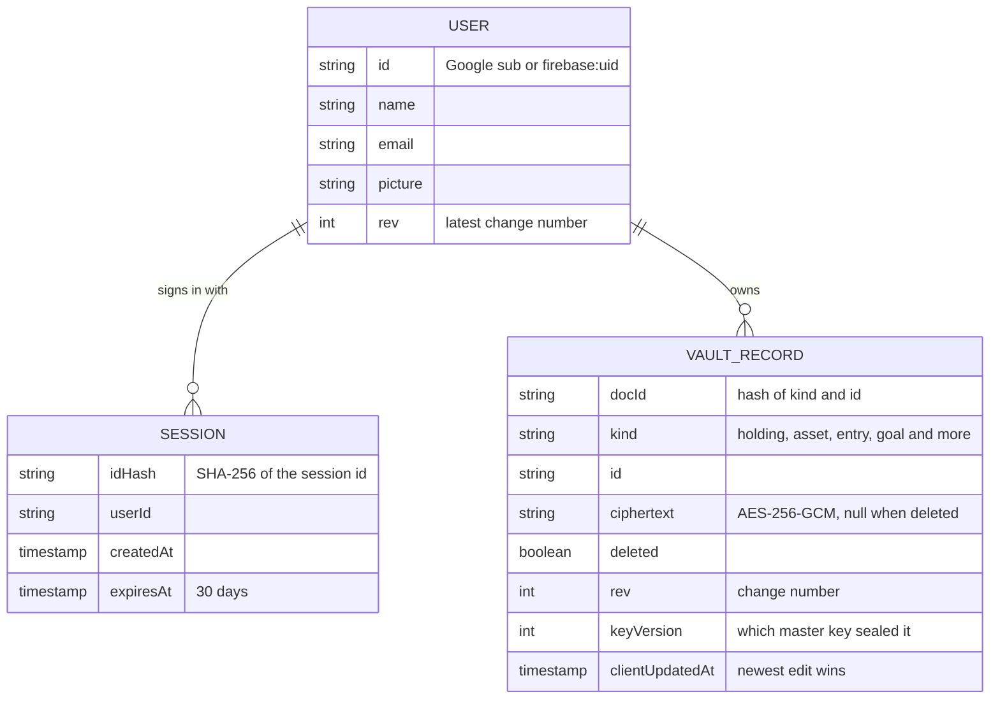

| Record kind | What it holds |
|---|---|
| `holding` | One stock and its lot-by-lot buy history |
| `asset` | A bank balance, deposit, EPF, PPF, NPS, gold, property, crypto or a loan |
| `entry` | One income or expense |
| `goal` | A money goal and its target |
| `snapshot` | Net worth at a point in time, for history |
| `profile` | Name, city and whether the welcome setup is done |
| `brief` | A saved news brief |
| `expenses` | Spending imported from a linked account, with when it was synced |

### 7.2 Encryption

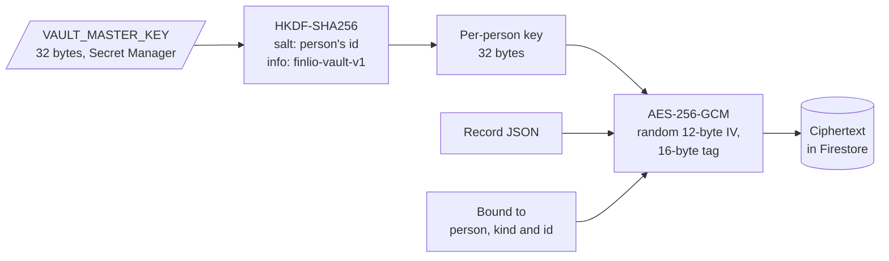

- Each person's records are sealed under their own key, derived from the
  master key. The master key lives in Secret Manager and never in the
  database, so a copy of the database alone reveals no amounts, names or notes.
- The person, kind and id are bound to each ciphertext as authenticated data,
  so a record cannot be moved to another person or swapped for another record
  without failing to decrypt.
- Records carry a key version (currently 1) so the master key can be rotated.
- The Finlio server can decrypt the data, which is how it shows people their
  own numbers on any device.

### 7.3 Sync between devices

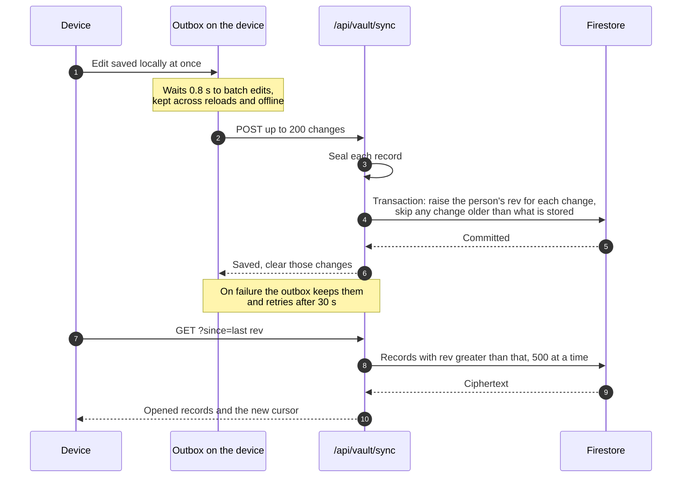

- **Ordering.** A per-person revision counter, raised inside a Firestore
  transaction, gives every change a place in order. A device asks only for
  what changed after the last revision it saw.
- **Conflicts.** The newest edit by the time it was made wins, so an old
  offline edit cannot overwrite a newer one.
- **Limits.** 200 changes per push, about 280 KB per record, 20,000 records
  per person.
- **Ownership.** Anyone can export all their data as CSV or JSON, or delete
  their account and its data, from Settings.

## 8. Market data

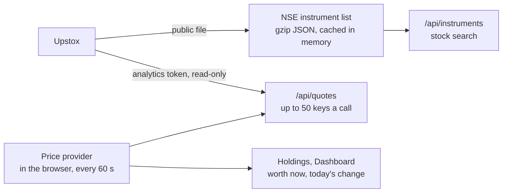

- Prices come from Upstox's read-only analytics token. Finlio never holds
  broker credentials and cannot place orders.
- Without the token, holdings still show what was paid, and the price card
  says live prices are not available rather than guessing.
- Broker exports from Zerodha, Groww, Upstox and Angel One are parsed in
  [lib/broker-csv.ts](lib/broker-csv.ts) and matched to NSE instruments.

## 9. Security architecture

### 9.1 Trust boundaries

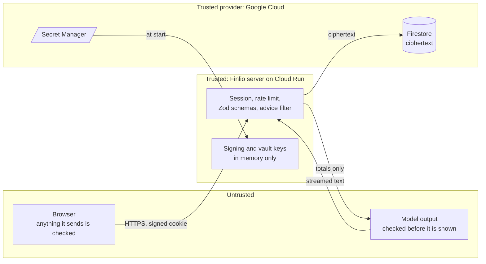

### 9.2 Controls

| Area | Control |
|---|---|
| Transport | HTTPS only; HSTS for two years including subdomains |
| Browser | Content Security Policy, `X-Frame-Options: DENY`, strict referrer policy; camera, microphone, location and payment turned off |
| Authentication | Google-signed ID tokens verified on the server; verified email required; sessions stored server-side and revocable |
| Authorisation | Every API route resolves the person from the session and reads or writes only their documents |
| Input | Every request body is validated with Zod, with size limits on every field |
| Abuse | Per-person and per-address request limits on every route; sign-in accepts same-site posts only |
| Data at rest | AES-256-GCM per person, keys derived with HKDF, master key in Secret Manager |
| Secrets | Secret Manager, read only by the Cloud Run service account; no key files in the image or repository |
| AI | Totals only to the model; data marked as data; every sentence filtered for advice |
| Outbound | Company logos fetched by the server from an allow-list, so the route is not an open proxy |
| Market data | Read-only token; no broker credentials; no order placement |

## 10. Delivery pipeline

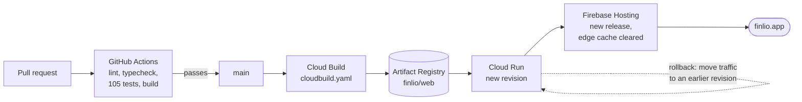

CI runs on every pull request and every push to `main`. A release builds the
image with the four public Firebase values baked into the browser code,
deploys it as a new Cloud Run revision, and publishes a Hosting release so the
edge stops serving pages from the previous build.

## 11. Quality attributes

| Attribute | How the design delivers it |
|---|---|
| **Privacy** | Totals only to the model; per-person encryption at rest; no passwords on Finlio's server; data export and deletion in Settings |
| **Safety of advice** | Two independent layers (prompt and sentence filter), tested in six languages |
| **Latency** | Region in Mumbai; streamed answers; a small model with minimal thinking |
| **Cost** | Scale to zero; small model with an 800-token cap; rate limits on every AI route |
| **Availability** | Gemini key failover; offline edits kept in the outbox and retried; instant rollback to a previous revision |
| **Consistency** | Transactional revision counter; newest edit wins; paged pulls |
| **Portability** | One container; runs on Cloud Run or Vercel with the same code; Firestore emulator for local work |
| **Known limits** | Rate limits are counted per instance, not globally; the server can decrypt data by design; prices depend on Upstox being available |

## Built for how money is held in India

| Area | What Finlio understands |
|---|---|
| Stocks | NSE equities with live prices from Upstox, lot-by-lot buy history, and holdings imported from a Zerodha, Groww, Upstox or Angel One CSV export |
| Savings and retirement | Bank balances, fixed deposits, EPF, PPF and NPS |
| Other assets | Gold, property and crypto |
| Loans | Home, car, education and personal loans, and credit cards |
| Numbers | Rupees written the Indian way: ₹1,00,000 and ₹1.2 crore |
| Time | Quarters of the Indian financial year, Q1 (April–June) to Q4 (January–March) |
| Language | English, Hindi, Tamil, Telugu, Kannada and Marathi, for both the app and the chat |

## What the numbers show

| Measured | Result |
|---|---|
| One chat answer on `gemini-3.5-flash-lite` | About 1,240 tokens in and under 100 out, a small fraction of a rupee at paid rates |
| Advice requests, tested live in English and Hindi | "Which stock should I buy?" and "Should I sell Infosys?" were declined, and the person's own figures were explained instead |
| Greetings, tested live in English and Hindi | "Hi", "good morning" and "नमस्ते" each got one short line back |
| Test suite | 105 tests across 16 files: encryption, sync, broker CSV parsing, sign-in tokens, the advice filter and the chat prompt |

## Run it locally

```bash
git clone https://github.com/Gokulakrishnxn/Finlioo.git
cd Finlioo
pnpm install
cp .env.example .env.local
pnpm dev
```

Open <http://localhost:3000> for the landing page and
<http://localhost:3000/dashboard> for the app. With an empty `.env.local`, the
app runs without sign-in and keeps everything in the browser, which is enough
to try every screen. Each key you add turns on one more piece:

| Add to `.env.local` | What starts working |
|---|---|
| `GEMINI_API_KEY` (from [Google AI Studio](https://aistudio.google.com/apikey)) | Finlio chat and the Analytics summaries |
| `UPSTOX_ANALYTICS_TOKEN` | Live NSE prices and "Worth now" for holdings |
| `GCP_PROJECT_ID`, `AUTH_SECRET`, `VAULT_MASTER_KEY`, and `gcloud auth application-default login` | Accounts and encrypted storage in Firestore |
| The four `NEXT_PUBLIC_FIREBASE_*` values | Google and email-and-password sign-in through Firebase Auth |

## Deploy

**Once per project.** Turn on the services, make an image repository, and
store the three secrets (each `printf` takes the value from your `.env.local`):

```bash
gcloud services enable run.googleapis.com cloudbuild.googleapis.com artifactregistry.googleapis.com secretmanager.googleapis.com firestore.googleapis.com
gcloud artifacts repositories create finlio --repository-format=docker --location=asia-south1
printf '%s' "$AUTH_SECRET" | gcloud secrets create auth-secret --data-file=-
printf '%s' "$VAULT_MASTER_KEY" | gcloud secrets create vault-master-key --data-file=-
printf '%s' "$GEMINI_API_KEY" | gcloud secrets create gemini-api-key --data-file=-
```

Give the Cloud Run service account the Secret Manager Secret Accessor role on
each secret. After the first deploy, add the service's domain and your custom
domain to Firebase Authentication's authorized domains.

**Every release.** Build with [cloudbuild.yaml](cloudbuild.yaml), which bakes
the four public Firebase values into the browser code, then deploy:

```bash
gcloud builds submit --config=cloudbuild.yaml --region=asia-south1 \
  --substitutions=_FB_API_KEY=...,_FB_AUTH_DOMAIN=...,_FB_PROJECT_ID=...,_FB_APP_ID=...
gcloud run deploy finlio --region=asia-south1 --allow-unauthenticated \
  --image=asia-south1-docker.pkg.dev/YOUR_PROJECT_ID/finlio/web:latest \
  --set-env-vars=GCP_PROJECT_ID=YOUR_PROJECT_ID,APP_URL=https://finlio.app \
  --set-secrets=AUTH_SECRET=auth-secret:latest,VAULT_MASTER_KEY=vault-master-key:latest,GEMINI_API_KEY=gemini-api-key:latest
```

**Then clear the edge cache.** Firebase Hosting caches the pages Next.js
prerenders (the landing page among them) for up to a year, so after each
deploy it would keep serving the previous build. A new Hosting release clears
that cache; [scripts/release-hosting.sh](scripts/release-hosting.sh) publishes
one with only `gcloud`:

```bash
scripts/release-hosting.sh YOUR_PROJECT_ID
```

**Custom domain.** [firebase.json](firebase.json) sends every path on the
Firebase Hosting site to the `finlio` service; the release script publishes
the same rule. Connect the domain under Firebase Hosting and add the DNS
records it lists at your registrar.

[docs/gcp-setup.md](docs/gcp-setup.md) covers the rest of the Google Cloud
setup (Firebase Auth, send-only email) and hosting on Vercel instead.

## Operations

- **Logs.** Cloud Run sends server logs to Cloud Logging. AI routes log a
  warning each time the advice filter stops a reply.
- **Releases.** Each deploy is a new Cloud Run revision, followed by a Hosting
  release that clears the edge cache. Rolling back is moving traffic to the
  previous revision.
- **Scaling.** The service scales to zero when idle and up to five instances.
  Request limits are counted in each instance's memory, which stops one client
  flooding an instance but is not a global quota.
- **Rotating a secret.** Add a new version in Secret Manager and redeploy;
  the service reads `latest` when a revision starts.

## Repository map

| Path | What lives there |
|---|---|
| [app/](app) | Pages (marketing and app screens) and API routes under `app/api` |
| [components/](components) | Interface, including the chat in `components/chat` |
| [lib/chat-prompt.ts](lib/chat-prompt.ts), [lib/ai-guard.ts](lib/ai-guard.ts), [lib/gemini.ts](lib/gemini.ts) | The AI layer: instructions, advice filter, model client |
| [lib/auth/](lib/auth) | Firebase token verification, sessions, cookies |
| [lib/vault/](lib/vault) | Encryption, record storage and device sync |
| [lib/gcp/](lib/gcp) | Firestore client and keyless Vercel access |
| [lib/upstox.ts](lib/upstox.ts), [lib/instruments.ts](lib/instruments.ts), [lib/broker-csv.ts](lib/broker-csv.ts) | Market data and broker imports |
| [lib/i18n/](lib/i18n) | Interface text in six languages |
| [proxy.ts](proxy.ts) | Page gating for signed-in screens |
| [tests/](tests) | Vitest suites |
| [Dockerfile](Dockerfile), [cloudbuild.yaml](cloudbuild.yaml), [firebase.json](firebase.json), [scripts/release-hosting.sh](scripts/release-hosting.sh) | Build, hosting and release |

## Development

```bash
pnpm test        # Vitest
pnpm typecheck   # TypeScript
pnpm lint        # ESLint
pnpm build       # Production build
```

CI runs all four on every pull request. Anything that changes what the chat
or the Analytics summaries can say needs a test in
[tests/chat-prompt.test.ts](tests/chat-prompt.test.ts) or
[tests/ai-guard.test.ts](tests/ai-guard.test.ts).

## Team

| Gokulakrishnan | Priyadarsni JK | Fairoz Ahmed |
|---|---|---|
| [@Gokulakrishnxn](https://github.com/Gokulakrishnxn) · Product engineering and cloud systems | Co-creator and product architect · AI interaction and localization | Co-creator and systems engineer · Financial intelligence and data pipelines |

Built for the Gemini 4 Sprints, presented by Google DeepMind and Google Cloud,
Bengaluru, November 2026.

Finlio is not a SEBI-registered investment adviser or research analyst, and
nothing in it is investment advice.
