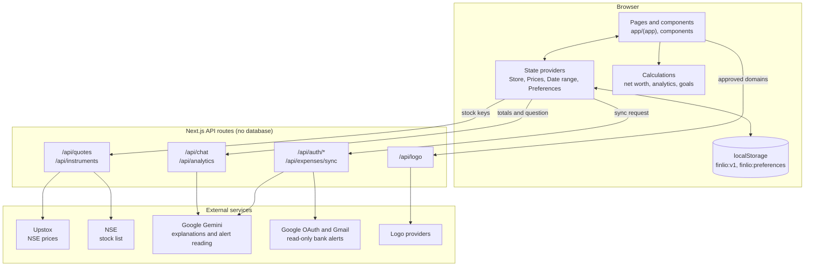
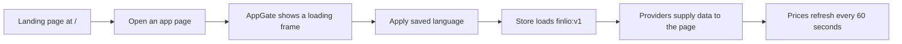
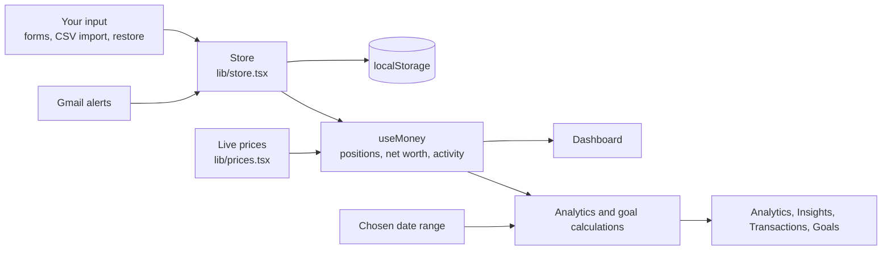
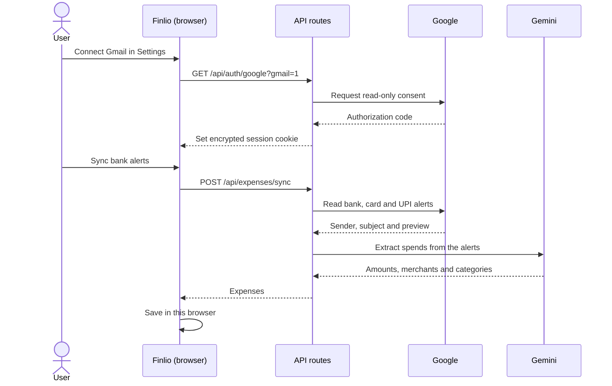

# Finlio

**All your money in one place.** Finlio is a personal finance app for people in India. It brings investments, assets, liabilities, spending and savings goals together, with analytics that show how they change over time.

Finlio explains your numbers. It does not give financial advice.

## Features

| Area | What it does |
|---|---|
| **Dashboard** | Net worth, this month's cash flow, recent activity and stocks at a glance |
| **Analytics** | Income, spending, savings rate, top categories and merchants, compared with the previous period |
| **Insights** | Allocation, money flow and a plain-language AI summary of your totals |
| **Holdings** | NSE stocks with live prices and gain or loss, plus Zerodha Kite CSV import |
| **Assets and Liabilities** | Bank balances, deposits, gold, EPF, PPF, NPS, property, loans and credit cards |
| **Transactions** | Manual income and expenses, plus optional reading of bank alerts from Gmail |
| **Goals** | Savings targets, monthly amount needed, current pace and projected finish date |
| **Finlio chat** | Ask questions about your own money, answered from your totals |

**Also included:** date, month, year and Indian financial year filters, light and dark themes, a hide amounts mode, lakh/crore or million number formats, backup and restore, and six languages (English, Hindi, Tamil, Telugu, Kannada and Marathi).

## System architecture

Finlio is a Next.js application with a **local-first** design. Financial data stays in the browser. The server side is a set of thin, stateless API routes that keep API keys private and connect to outside services.



### Design principles

- **Local-first:** the browser is the source of truth. There is no user database.
- **Minimum data sharing:** AI features receive totals and percentages, never transactions or share quantities. Reading bank alerts is the one exception, and only runs if you connect Gmail.
- **Keys stay on the server:** the browser only talks to Finlio's own API routes.
- **Honest numbers:** comparisons use matching periods, and unfinished periods are labelled.

## How data flows

### Opening the app

The landing page at `/` is rendered on the server and works without any saved data. App pages are different: the server sends a loading frame with no text, because it cannot know this browser's data or language. The app then renders once on the client, already in the right language.



### From data to screen

Every figure is calculated when needed, so all pages stay consistent with the data you've saved.



### Connecting Gmail

This flow is optional. Tokens are kept in an encrypted, `httpOnly` cookie, and extracted spends are saved only in the browser.



## Tech stack

| Layer | Technology |
|---|---|
| Framework | Next.js 16 (App Router), React 19, TypeScript |
| Styling | Tailwind CSS 4, design tokens in `app/globals.css` |
| Components | Base UI, Radix Dialog, uiarc, easyui, transitions.dev |
| Motion | Motion, respecting the reduced-motion setting; Lenis for landing page scrolling |
| Dates | React Day Picker, date-fns |
| Validation | Zod |
| AI | Google Gemini (`@google/genai`) |
| Market data | Upstox API, NSE stock list |
| Package manager | pnpm |

## Getting started

### Requirements

- Node.js
- pnpm 9

### Run locally

```bash
pnpm install
```

```bash
cp .env.example .env.local
```

```bash
pnpm dev
```

Open http://localhost:3000 for the landing page, or http://localhost:3000/dashboard for the app.

The app runs without any API keys. Features that need a key show a clear message until one is added.

### Environment variables

| Variable | Enables |
|---|---|
| `UPSTOX_ANALYTICS_TOKEN` | Live NSE prices |
| `GEMINI_API_KEY` | Finlio chat, Insights summaries and reading bank alerts |
| `GEMINI_MODEL` | Optional. Overrides the default Gemini model |
| `GOOGLE_CLIENT_ID`, `GOOGLE_CLIENT_SECRET` | Connecting Gmail |
| `AUTH_SECRET` | Encrypting the Google session cookie. Use a long random string |

Never commit real keys. `.env.local` is ignored by git.

### Commands

| Command | Purpose |
|---|---|
| `pnpm dev` | Start the development server |
| `pnpm build` | Create a production build |
| `pnpm start` | Serve the production build |
| `pnpm lint` | Run ESLint |
| `pnpm exec tsc --noEmit` | Run the type-check |

## Project structure

```text
app/
├── (app)/            App pages: dashboard, analytics, insights, holdings,
│                     assets, liabilities, transactions, goals, terms
├── (marketing)/      Public pages: landing page at / and cookies
├── api/              Server routes for prices, AI, Gmail and logos
└── layout.tsx        Root layout, fonts and app-wide providers
components/
├── landing/          Landing page sections and the vendored stage-kit
├── analytics/        Charts and chart cards
├── goals/            Goal and add-money dialogs
├── settings/         Settings window
├── shell/            Sidebar and mobile navigation
├── chat/             Finlio chat
├── arc/, ui/         Base components
└── app-gate.tsx      Client-only start, so the language is right first time
lib/
├── store.tsx         Saved data and every action that changes it
├── prices.tsx        Live price polling
├── use-money.ts      Positions, net worth and activity for pages
├── networth.ts       Net worth, allocation and period totals
├── analytics.ts      Cash flow, categories, merchants and trends
├── goals.ts          Goal progress, pace and status
├── date-range.ts     Presets, financial years and period comparison
├── preferences.ts    Language, number format and display settings
├── i18n/             Translations, keyed by the English text
├── landing-*.ts      Landing page content and pricing
└── google-session.ts Google OAuth and the encrypted session
public/marketing/     Landing page images
docs/landing.md       Landing page brief and copy
```

## Data and privacy

| Data | Where it lives |
|---|---|
| Holdings, assets, liabilities, income, spending, goals and profile | This browser, in `localStorage` |
| Language and display preferences | This browser, in `localStorage` |
| Google tokens, if Gmail is connected | Encrypted `httpOnly` cookie (AES-256-GCM) |
| Everything else | Not stored by Finlio |

People can export a backup, restore it in another browser, or erase everything from **Settings → Data controls**. The Terms page lists exactly what is sent to each outside service.

## Adding a language

1. Add a dictionary in `lib/i18n/`, keyed by the English text.
2. Register it in `lib/i18n/index.ts` and in `LANGUAGES` in `lib/preferences.ts`.
3. Add its font in `app/layout.tsx` if the script needs one.

Any missing phrase falls back to English and logs a warning during development.

## Known limitations

- **Single browser:** data does not sync between devices, and clearing browser data removes it unless a backup was exported.
- **Unencrypted local storage:** saved data is readable by anyone with access to the browser profile.
- **Open API routes:** there are no accounts, so `/api/chat`, `/api/analytics` and the price routes need authentication and rate limits before a public launch, or anyone could use up the API keys.
- **No automated tests or CI yet:** checks are currently the build, type-check and lint, run locally.
- **Translations are drafts:** they need review by fluent speakers before launch. Terms and Cookies are in English only.
- **Market holidays:** market open and closed status does not account for exchange holidays.

## Roadmap

- Accounts and secure, encrypted server storage with multi-device sync
- API authentication and rate limiting
- Automated tests and CI

## License

[MIT](LICENSE) © 2026 Gokulakrishnan
