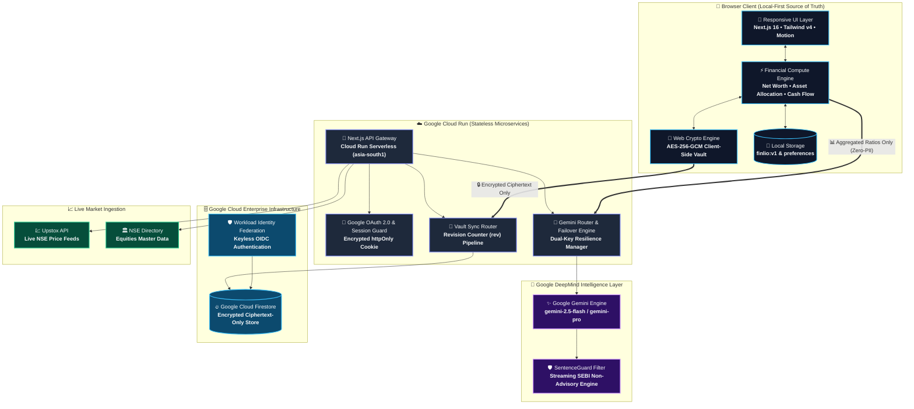
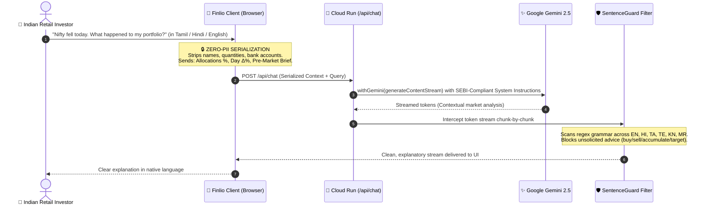
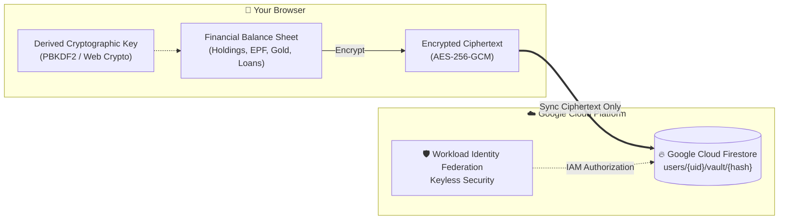

<div align="center">

# Finlio
### *All your money in one place. Real clarity on why it moved.*

**Built for 100M+ Indian retail investors. Powered by Google Gemini & Google Cloud.**

<br/>

[](https://ai.google.dev/)
[](https://cloud.google.com/run)
[](https://cloud.google.com/firestore)
[](https://nextjs.org/)
[](https://www.typescriptlang.org/)
[](#-the-architecture-of-trust)

<br/>

[The Vision](#-the-vision) • [Three Breakthroughs](#-three-breakthroughs-one-platform) • [System Architecture](#%EF%B8%8F-system-architecture) • [Gemini Intelligence](#-the-gemini-intelligence-engine) • [Live Demo & Setup](#-getting-started) • [The Team](#-the-team)

</div>

---

## 💡 The Vision

> *"Every day at 9:15 AM, over 100 million Indian investors open their broker apps. They see red. They see green. But they don't know **why**.*  
> *It's not that people don't care about their money. It's that the tools built for them speak a foreign language.*  
> *Today, we change that."*

```
┌────────────────────────────────────────────────────────────────────────────────────────┐
│ THE STATUS QUO IS BROKEN                                                               │
├────────────────────────────────────────────────────────────────────────────────────────┤
│  Stocks in Zerodha  •  Mutual Funds in Groww  •  Retirement in EPFO  •  Gold at Home   │
│  Fixed Deposits in HDFC  •  UPI Spends on GPay  •  News on Moneycontrol                │
└────────────────────────────────────────────────────────────────────────────────────────┘
                                           ▼
              "Nifty drops 350 pts as US yields spike & crude surges"
                                (Market Jargon)
                                           ▼
        "Why did MY portfolio drop ₹14,200 today? What happened to my money?"
                             (Retail investors left guessing)
```

**Finlio** replaces the chaos with absolute clarity. One unified net worth, an intelligent morning brief before market open, and an AI companion that speaks your mother tongue—all built on an unbreakable foundation of **zero-knowledge privacy**.

---

## ⚡ Three Breakthroughs. One Platform.

### 1. Unified Indian Balance Sheet
The first platform built ground-up for the Indian wealth reality: **NSE Equities**, **Mutual Funds**, **EPF**, **PPF**, **NPS**, **Fixed Deposits**, **Physical Gold**, and **Real Estate**—calculated in **Lakhs & Crores** and aligned to the **Indian Financial Year**.

### 2. Pre-Market Intelligence (Powered by Gemini)
Before the opening bell at 9:15 AM IST, Finlio analyzes overnight domestic and global market movements and translates them into a single, plain-language morning brief explaining exactly why the assets **you** own are moving.

### 3. Absolute Privacy by Design
Trust is not a marketing promise; it is an architectural guarantee. Your financial records are encrypted client-side using **AES-256-GCM** before touching Google Cloud. **Google Gemini only sees anonymized mathematical totals—never your transactions, quantities, or account numbers.**

---

## 🏗️ System Architecture

Finlio is engineered with a **Local-First, Zero-Knowledge topology**. The browser is the single source of truth; the Google Cloud backend acts as a high-speed, stateless gateway for market intelligence and encrypted synchronization.

### High-Level Architecture Topology



---

### Technology Matrix & Stack

| Layer | Technology | Brand Logo / Icon | Architectural Responsibility |
|---|---|:---:|---|
| **AI Engine** | **Google Gemini** |  | Multi-turn financial reasoning, news synthesis, pre-market briefs |
| **Compute** | **Google Cloud Run** |  | Containerized stateless serverless deployment (Mumbai: `asia-south1`) |
| **Encrypted Vault** | **Google Cloud Firestore** |  | Client-encrypted revision-based persistent synchronization |
| **Authentication** | **Workload Identity** |  | Keyless OIDC connection between Vercel/Cloud Run and Google Cloud |
| **Frontend Framework** | **Next.js 16 (App Router)** |  | React 19 server/client components, Turbopack, partial prefetching |
| **Styling & Motion** | **Tailwind CSS 4 + Motion** |  | Fluid design tokens, dark/light themes, accessible reduced motion |
| **Market Data** | **Upstox API & NSE** |  | Real-time Indian equities tick data, automated symbol mapping |

---

## 🔮 The Gemini Intelligence Engine

Finlio implements Gemini not as an external novelty, but as a deeply embedded, mathematically constrained analytical co-pilot.



### 1. Zero-PII Context Mathematical Reduction
Financial privacy is our primary constraint. Gemini is never exposed to personal data:
* ❌ **Never Transmitted**: Bank names, account numbers, share quantities, buying prices, transaction logs, or user credentials.
* ✅ **Transmitted**: Normalized portfolio weightings (`%`), aggregate net worth delta (`%`), sector distribution (`%`), and the curated morning news brief.

### 2. Native Multi-Lingual Reasoning (6 Languages)
Gemini natively articulates complex financial mechanics across:
* **English**
* **Hindi (हिन्दी)**
* **Tamil (தமிழ்)**
* **Telugu (తెలుగు)**
* **Kannada (ಕನ್ನಡ)**
* **Marathi (मराठी)**

All financial outputs strictly honor the Indian numerical system (**Lakhs and Crores**).

### 3. Real-Time `SentenceGuard` (SEBI Non-Advisory Guardrail)
Indian regulations (SEBI) rightly prohibit unlicensed entities from providing stock recommendations. Finlio enforces this algorithmically via `SentenceGuard`:
* Intercepts Gemini's streaming output buffer in real-time.
* Detects actionable trading imperatives (*"buy", "sell", "book profit", "வாங்கவும்", "வாங்கலாம்", "ಖರೀದಿಸಿ", "खरीदें"*) across all supported languages.
* Automatically halts the stream and renders an explicit compliance notification if advisory language is generated.

### 4. Dual-Key Enterprise Quota Failover (`withGemini`)
Production environments cannot fail on 429 rate limits. Finlio implements an automated dual-key round-robin failover manager:
```typescript
// Seamless failover across Google AI Studio / GCP Project credentials
export async function withGemini<T>(call: (ai: GoogleGenAI) => Promise<T>): Promise<T> {
  const keys = geminiKeys();
  for (const apiKey of keys) {
    try {
      return await call(new GoogleGenAI({ apiKey }));
    } catch (err) {
      if (!retryable(err)) throw err;
      // Instantly cascades to secondary key on 429 / RESOURCE_EXHAUSTED
    }
  }
}
```

---

## 🔒 The Architecture of Trust



* **Client-Side AES-256-GCM Encryption**: Data is sealed on the device before transmission. Google Cloud stores only opaque encrypted blobs.
* **Revision-Based Synchronization (`rev`)**: Offline-first conflict resolution ensures seamless multi-device convergence without central decryption.
* **Keyless Workload Identity**: Zero static service account keys stored on servers, eliminating credential leakage vectors.
* **One-Click Total Data Erasure**: Users retain complete sovereignty to export JSON/CSV backups or permanently delete their cloud vault instantly.

---

## 🇮🇳 Engineered for India

| Category | Native Instrument Coverage |
|---|---|
| **Market Equities** | Real-time NSE ticker updates via Upstox, lot-wise purchase tracking, 1-click Zerodha Kite CSV imports. |
| **Retirement Vehicles** | Employees' Provident Fund (EPF), Public Provident Fund (PPF), National Pension System (NPS). |
| **Traditional Wealth** | Physical Sovereign Gold / Digital Gold, Real Estate & Property equity. |
| **Liabilities & Debt** | Home loans, Education loans, Car loans, and Credit Cards. |
| **Localization** | Native Lakhs (₹1,00,000) and Crores (₹1,00,00,000) formatting. |
| **Fiscal Calendar** | Indian Financial Year (April 1 – March 31) quarterly tracking (Q1–Q4). |

---

## 🚀 Getting Started

### Prerequisites
* Node.js 20+
* `pnpm` (v9+)
* Google Gemini API Key ([Google AI Studio](https://aistudio.google.com/))
* *(Optional)* Upstox API credentials for live stock feeds
* *(Optional)* Google Cloud Project with Firestore enabled

### 1. Quickstart Development

```bash
# Clone the repository
git clone https://github.com/Gokulakrishnxn/Finlioo.git
cd Finlioo

# Install dependencies
pnpm install

# Setup environment variables
cp .env.example .env.local
```

Add your credentials to `.env.local`:
```env
GEMINI_API_KEY="your-google-ai-studio-key"
GEMINI_API_KEY_2="optional-secondary-key"
UPSTOX_ANALYTICS_TOKEN="optional-upstox-token"
```

Start the local server:
```bash
pnpm dev
```
Open **[http://localhost:3000](http://localhost:3000)** for the landing experience, or **[http://localhost:3000/dashboard](http://localhost:3000/dashboard)** for the application.

---

## ☁️ Google Cloud Deployment (Cloud Run)

Finlio is pre-configured for automated container deployment to **Google Cloud Run**.

```bash
# 1. Authenticate and configure Google Cloud
gcloud config set project YOUR_PROJECT_ID
gcloud services enable run.googleapis.com firestore.googleapis.com cloudbuild.googleapis.com

# 2. Build container image using Cloud Build
gcloud builds submit --tag gcr.io/YOUR_PROJECT_ID/finlio

# 3. Deploy to Cloud Run (Mumbai Region)
gcloud run deploy finlio \
  --image gcr.io/YOUR_PROJECT_ID/finlio \
  --platform managed \
  --region asia-south1 \
  --allow-unauthenticated \
  --set-env-vars GEMINI_API_KEY=your-gemini-key,GEMINI_MODEL=gemini-2.5-flash
```

---

## 🧪 Comprehensive Verification Suite

Finlio is tested across cryptographic integrity, AI guardrails, and financial calculation models:

```bash
# Run the test suite (Vitest) - 15 suites, 98 tests
pnpm test

# Run static type checking
pnpm typecheck

# Run ESLint quality checks
pnpm lint
```

* `vault-crypto.test.ts`: Validates Web Crypto AES-256-GCM encryption, decryption, and PBKDF2 key derivation.
* `ai-guard.test.ts`: Verifies real-time SEBI advisory pattern interception across English and Indian scripts.
* `vault-sync.test.ts`: Validates offline reconciliation and Firestore revision ordering.
* `broker-csv.test.ts`: Verifies Zerodha Kite CSV tradebook parsing.

---

## 👥 The Team

<div align="center">

| **Gokulakrishnan** | **Priyadarsni JK** | **Fairoz Ahmed** |
|:---:|:---:|:---:|
| [@Gokulakrishnxn](https://github.com/Gokulakrishnxn) | Co-Creator & Product Architect | Co-Creator & Systems Engineer |
| *Product Engineering & Cloud Systems* | *AI Interaction & Localization* | *Financial Intelligence & Data Pipelines* |

<br/>

**Built with focus and conviction for the Gemini 4 Sprints**  
*Presented by Google DeepMind and Google Cloud • Bengaluru, November 2026*

</div>

---

<div align="center">
<sub>Finlio is designed to give Indian retail investors clarity, not speculation. All your money in one place. Real clarity on why it moved.</sub>
</div>
