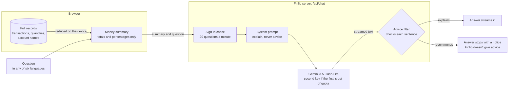
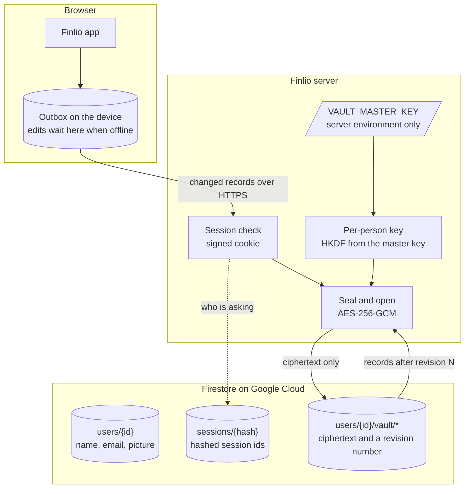

# Finlio

Finlio adds up everything a person in India owns and owes, and explains in
plain language what changed and why. Stocks, bank balances, fixed deposits,
EPF, PPF, NPS, gold, property and loans sit on one balance sheet, counted in
lakhs and crores across the April–March financial year. Its chat answers
questions about that money in six languages. It explains. It never tells
anyone what to buy, sell or hold.

Next.js 16 · Gemini 3.5 Flash-Lite · Cloud Run and Firestore on Google Cloud · Firebase Auth · Private source

| If you want to… | Start here |
|---|---|
| Run Finlio on your machine in five minutes | [Run it locally](#run-it-locally) |
| See how a chat question becomes an answer | [How Finlio chat answers](#how-finlio-chat-answers) |
| Know exactly where money data is stored and who can read it | [Where the data lives](#where-the-data-lives) |
| Deploy it with sign-in, cloud storage and email | [Deploy](#deploy) and [docs/gcp-setup.md](docs/gcp-setup.md) |
| Change what the chat is allowed to say | [lib/chat-prompt.ts](lib/chat-prompt.ts) and [lib/ai-guard.ts](lib/ai-guard.ts) |

## Run it locally

```bash
git clone https://github.com/Gokulakrishnxn/Finlioo.git
cd Finlioo
pnpm install
cp .env.example .env.local
pnpm dev
```

Open <http://localhost:3000> for the landing page and
<http://localhost:3000/dashboard> for the app. With an empty `.env.local`, the
app runs without sign-in and keeps everything in the browser, which is enough
to try every screen. Each key you add turns on one more piece:

| Add to `.env.local` | What starts working |
|---|---|
| `GEMINI_API_KEY` (free from [Google AI Studio](https://aistudio.google.com/apikey)) | Finlio chat and the Insights summaries |
| `UPSTOX_ANALYTICS_TOKEN` | Live NSE prices for holdings |
| `GCP_PROJECT_ID`, `AUTH_SECRET`, `GOOGLE_CLIENT_ID`, `GOOGLE_CLIENT_SECRET`, `VAULT_MASTER_KEY` | Sign-in, and encrypted storage in Firestore |
| The four `NEXT_PUBLIC_FIREBASE_*` values | Email-and-password sign-in through Firebase Auth |

## Built for how money is held in India

| Area | What Finlio understands |
|---|---|
| Stocks | NSE equities with live prices from Upstox, lot-by-lot buy history, and holdings imported from a Zerodha, Groww, Upstox or Angel One CSV export |
| Savings and retirement | Bank balances, fixed deposits, EPF, PPF and NPS |
| Other assets | Gold, property and crypto |
| Loans | Home, car, education and personal loans, and credit cards |
| Numbers | Rupees written the Indian way: ₹1,00,000 and ₹1.2 crore |
| Time | Quarters of the Indian financial year, Q1 (April–June) to Q4 (January–March) |
| Language | English, Hindi, Tamil, Telugu, Kannada and Marathi, for both the app and the chat |

## How Finlio chat answers

The browser never sends Gemini a transaction, a merchant, an account number
or a share quantity. It works out totals and percentages on the device and
sends only those. The server adds the rules, Gemini writes the answer, and
every sentence is checked for advice before the person sees it.



Three layers keep the chat on the right side of the line between explaining
and advising:

1. **The prompt** ([lib/chat-prompt.ts](lib/chat-prompt.ts)) forbids recommending
   any action with money, naming or ranking a product, and predicting prices.
   It also shows the model how to decline: say Finlio explains rather than
   advises, explain the person's own numbers instead, and point to a
   SEBI-registered investment adviser.
2. **The data** goes to the model inside a marked block, as data, so a news
   headline that reads like an instruction is not followed.
3. **The advice filter** ([lib/ai-guard.ts](lib/ai-guard.ts)) reads the reply
   one sentence at a time in all six languages. If a sentence recommends an
   action, the reply stops there and the person sees a short notice instead.
   Refusals such as "I can't tell you which share to buy" pass through.

## Where the data lives

Money data is encrypted on the Finlio server before it is written to
Firestore. Each person's records are sealed with AES-256-GCM, under a key
derived for that person from a master key. The master key is kept in the
server's environment and never stored in the database. A copy of the database
alone reveals no amounts, names or notes. The Finlio server can decrypt the
data, which is how it shows people their own numbers.



Each change raises a revision counter, so a device asks only for what changed
since it last synced, and the newest edit wins when two devices disagree.
Anyone can export all their data as CSV or JSON, or delete their account and
its data, from Settings. The server holds no service-account key file: on
Cloud Run it reaches Firestore as the service's own Google identity, and on
Vercel through Workload Identity Federation.

Google sign-in shares a name, an email address and a profile picture.
With email and password, Firebase Auth stores and checks the password, and
the Finlio server only verifies the signed token Firebase issues. Finlio
never reads anyone's mailbox.

## What the numbers show

| Measured | Result |
|---|---|
| One chat answer on `gemini-3.5-flash-lite` | About 1,240 tokens in and under 100 out, a small fraction of a rupee at paid rates |
| Advice requests, tested live in English and Hindi | "Which stock should I buy?" and "Should I sell Infosys?" were declined, and the person's own figures were explained instead |
| Test suite | 104 tests across 16 files: encryption, sync, broker CSV parsing, sign-in tokens, the advice filter and the chat prompt |

## Deploy

Finlio runs on Cloud Run in Mumbai (`asia-south1`), next to its Firestore
database. On Cloud Run the server reaches Firestore as the service's own
Google identity, so there is no key file. Secrets live in Secret Manager.

**Once per project.** Turn on the services, make an image repository, and
store the three secrets (each `printf` takes the value from your `.env.local`):

```bash
gcloud services enable run.googleapis.com cloudbuild.googleapis.com artifactregistry.googleapis.com secretmanager.googleapis.com firestore.googleapis.com
gcloud artifacts repositories create finlio --repository-format=docker --location=asia-south1
printf '%s' "$AUTH_SECRET" | gcloud secrets create auth-secret --data-file=-
printf '%s' "$VAULT_MASTER_KEY" | gcloud secrets create vault-master-key --data-file=-
printf '%s' "$GEMINI_API_KEY" | gcloud secrets create gemini-api-key --data-file=-
```

Give the Cloud Run service account the Secret Manager Secret Accessor role on
each secret, and add the service's `run.app` domain to Firebase
Authentication's authorized domains after the first deploy.

**Every release.** Build with [cloudbuild.yaml](cloudbuild.yaml), which bakes
the four public Firebase values into the browser code, then deploy:

```bash
gcloud builds submit --config=cloudbuild.yaml --region=asia-south1 \
  --substitutions=_FB_API_KEY=...,_FB_AUTH_DOMAIN=...,_FB_PROJECT_ID=...,_FB_APP_ID=...
gcloud run deploy finlio --region=asia-south1 --allow-unauthenticated \
  --image=asia-south1-docker.pkg.dev/YOUR_PROJECT_ID/finlio/web:latest \
  --set-env-vars=GCP_PROJECT_ID=YOUR_PROJECT_ID,APP_URL=https://YOUR_SERVICE_URL \
  --set-secrets=AUTH_SECRET=auth-secret:latest,VAULT_MASTER_KEY=vault-master-key:latest,GEMINI_API_KEY=gemini-api-key:latest
```

[docs/gcp-setup.md](docs/gcp-setup.md) covers the rest of the Google Cloud
setup (Firebase Auth, send-only email) and hosting on Vercel instead, with
keyless access through Workload Identity Federation.

## Development

```bash
pnpm test        # Vitest
pnpm typecheck   # TypeScript
pnpm lint        # ESLint
pnpm build       # Production build
```

CI runs all four on every pull request. Anything that changes what the chat
or the Insights summaries can say needs a test in
[tests/chat-prompt.test.ts](tests/chat-prompt.test.ts) or
[tests/ai-guard.test.ts](tests/ai-guard.test.ts).

## Team

| Gokulakrishnan | Priyadarsni JK | Fairoz Ahmed |
|---|---|---|
| [@Gokulakrishnxn](https://github.com/Gokulakrishnxn) · Product engineering and cloud systems | Co-creator and product architect · AI interaction and localization | Co-creator and systems engineer · Financial intelligence and data pipelines |

Built for the Gemini 4 Sprints, presented by Google DeepMind and Google Cloud,
Bengaluru, November 2026.

Finlio is not a SEBI-registered investment adviser or research analyst, and
nothing in it is investment advice.
