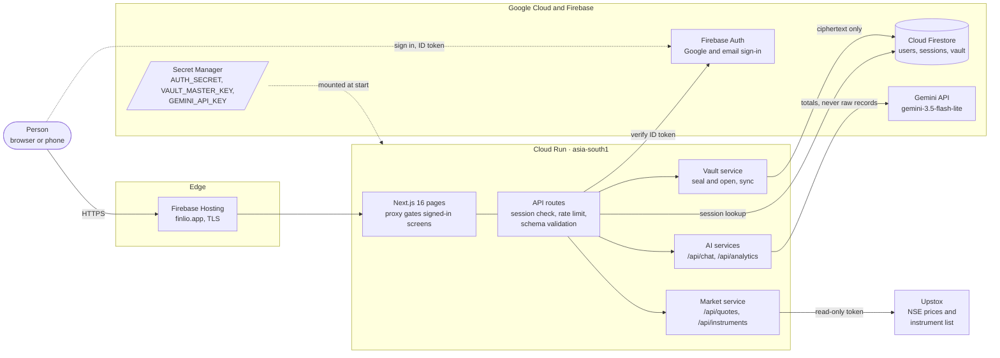
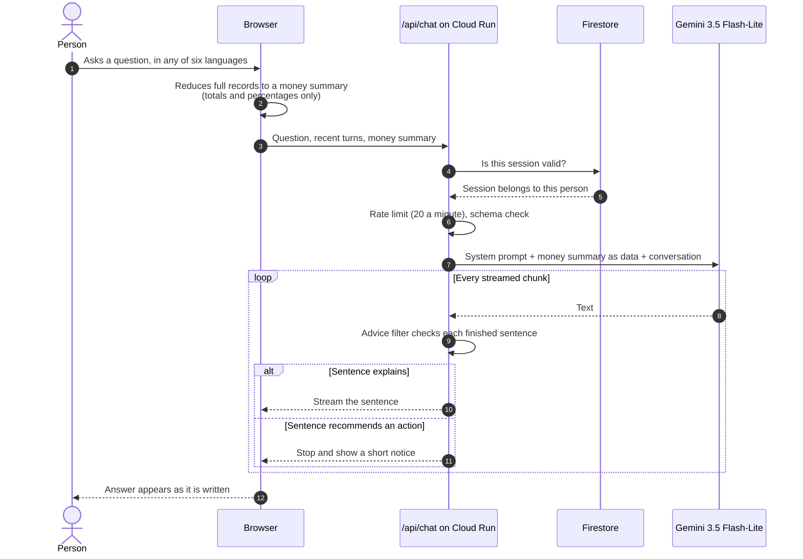
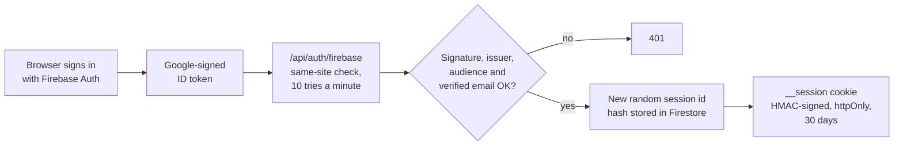
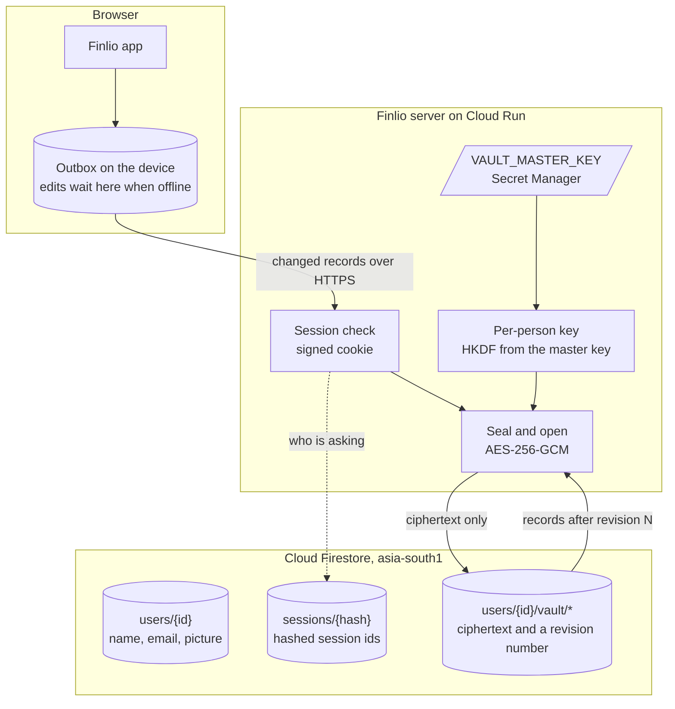

# Finlio

Finlio adds up everything a person in India owns and owes, and explains in
plain language what changed and why. Stocks, bank balances, fixed deposits,
EPF, PPF, NPS, gold, property and loans sit on one balance sheet, counted in
lakhs and crores across the April–March financial year. Its chat, built on
Google's Gemini, answers questions about that money in six languages. It
explains. It never tells anyone what to buy, sell or hold.

[finlio.app](https://finlio.app) · Next.js 16 on Cloud Run · Gemini 3.5 Flash-Lite · Firestore · Firebase Auth · Private source

| If you want to… | Start here |
|---|---|
| Understand the whole system on one page | [Architecture at a glance](#architecture-at-a-glance) |
| See how the AI is designed, bounded and kept from giving advice | [AI architecture](#ai-architecture) |
| Know exactly where money data is stored and who can read it | [Data architecture](#data-architecture) |
| Run Finlio on your machine in five minutes | [Run it locally](#run-it-locally) |
| Ship a release to Google Cloud | [Deploy](#deploy) |
| Change what the chat is allowed to say | [lib/chat-prompt.ts](lib/chat-prompt.ts) and [lib/ai-guard.ts](lib/ai-guard.ts) |

## Architecture at a glance

Finlio is one Next.js application on Cloud Run in Mumbai (`asia-south1`).
Firebase Hosting gives it the `finlio.app` domain and certificate and passes
every request through. The server is the only component that talks to the
database, the model and the market-data provider; the browser talks only to
Finlio and to Firebase Auth.



| Layer | Technology | Responsibility |
|---|---|---|
| Edge | Firebase Hosting | Custom domain, managed certificate, rewrite of every path to Cloud Run |
| Application | Next.js 16 (App Router, React 19, Turbopack), Node 22 container | Pages, API routes, server-side rendering, security headers |
| Identity | Firebase Auth, `jose` | Google and email-and-password sign-in; the server verifies Google-signed ID tokens and issues its own session |
| AI | Gemini API through `@google/genai` | Streaming chat and short written summaries of a person's totals |
| Data | Cloud Firestore (Native mode) | Accounts, hashed sessions, and each person's encrypted vault |
| Secrets | Secret Manager | Session signing key, vault master key, Gemini key, injected as environment variables |
| Market data | Upstox analytics API | Live NSE quotes and the daily instrument list, read-only |
| Delivery | Cloud Build, Artifact Registry, Cloud Run | Reproducible image builds from [cloudbuild.yaml](cloudbuild.yaml), revisions with instant rollback |

## AI architecture

Finlio uses AI for two jobs: answering questions in the chat, and writing a
few sentences that explain the Analytics screen. Both follow the same four
design principles.

| Principle | How it is enforced |
|---|---|
| **Explain, never advise.** | A system prompt with explicit rules and a worked refusal, plus a sentence-level filter on everything the model writes |
| **Send the model as little as possible.** | The browser reduces full records to totals and percentages; the server's schema rejects anything else |
| **Treat data as data.** | The person's numbers go to the model inside a marked `<money_summary>` block that the prompt says never to obey |
| **Bound the cost of every call.** | A small model, low temperature, minimal thinking, a hard output cap and per-person rate limits |

### How a chat question is answered



| | Chat | Analytics summary |
|---|---|---|
| Route | [app/api/chat/route.ts](app/api/chat/route.ts) | [app/api/analytics/route.ts](app/api/analytics/route.ts) |
| Input | Up to 30 turns, plus totals, category spending, allocation, each stock's daily and overall percentage change, and an optional goal | Net worth, assets, loans, period totals, category spending, allocation |
| Never sent | Transactions, merchants, account numbers, share quantities | Same |
| Output | Streamed text, under 120 words by default | Four to six one-sentence bullet points |
| Guardrails | Prompt rules, data block, streaming sentence filter | Prompt rules, filter on every bullet |
| Limit | 20 requests a minute per person | 5 requests a minute per person |

### Guardrails in depth

1. **The prompt** ([lib/chat-prompt.ts](lib/chat-prompt.ts)) forbids
   recommending any action with money, naming or ranking a product,
   predicting prices, and inventing numbers or reasons. It shows the model how
   to decline: say Finlio explains rather than advises, explain the person's
   own numbers instead, and point to a SEBI-registered investment adviser.
   Greetings get a single short line, and the chat says it runs on Gemini if
   asked.
2. **The data boundary.** The person's figures arrive inside
   `<money_summary>` tags and are declared to be data, so a news headline or
   a goal that reads like an instruction is not followed.
3. **The advice filter** ([lib/ai-guard.ts](lib/ai-guard.ts)) reads the reply
   one sentence at a time in English, Hindi, Tamil, Telugu, Kannada and
   Marathi. If a sentence recommends an action, the stream stops there and
   the person sees a short notice instead. Refusals such as "I can't tell you
   which share to buy" pass through, because they are recognised as refusals.
4. **Tests.** [tests/chat-prompt.test.ts](tests/chat-prompt.test.ts) and
   [tests/ai-guard.test.ts](tests/ai-guard.test.ts) pin the rules and check
   that the prompt's own example refusal passes the filter.

### Model choice and cost controls

| Control | Setting | Where |
|---|---|---|
| Model | `gemini-3.5-flash-lite`, overridable with `GEMINI_MODEL` | [lib/gemini.ts](lib/gemini.ts) |
| Sampling | Temperature 0.3 | [app/api/chat/route.ts](app/api/chat/route.ts) |
| Reasoning | Thinking level `MINIMAL` | same |
| Length | At most 800 output tokens per reply | same |
| Availability | A second key (`GEMINI_API_KEY_2`) answers when the first is out of quota or failing | [lib/gemini.ts](lib/gemini.ts) |
| Abuse | Per-person request limits on every AI route | [lib/api-guard.ts](lib/api-guard.ts) |

Flash-Lite is enough because every answer is an explanation of numbers the
app has already calculated. The model never does the arithmetic that the
balance sheet depends on.

## Identity and sessions



- ID tokens are verified against Google's published keys, the project's
  issuer and audience. Email sign-ups must verify their address first.
- The browser holds only a random session id signed with `AUTH_SECRET`.
  Firestore holds the session, so signing out or deleting an account ends it
  everywhere at once.
- Pages are gated by a fast signature check in [proxy.ts](proxy.ts). Every API
  route checks the session in Firestore before touching data.
- The cookie is named `__session` because it is the only cookie Firebase
  Hosting forwards to Cloud Run.

## Data architecture

Money data is encrypted on the Finlio server before it is written to
Firestore. Each person's records are sealed with AES-256-GCM under a key
derived for that person with HKDF-SHA256 from a master key. The master key
lives in Secret Manager and never in the database. A copy of the database
alone reveals no amounts, names or notes. The Finlio server can decrypt the
data, which is how it shows people their own numbers.



- **Sync.** Each change raises a revision counter, so a device asks only for
  what changed since it last synced, and the newest edit wins when two
  devices disagree.
- **Ownership.** Anyone can export all their data as CSV or JSON, or delete
  their account and its data, from Settings.
- **No key files.** On Cloud Run the server reaches Firestore as the
  service's own Google identity. On Vercel it uses Workload Identity
  Federation.
- **Passwords.** With email and password, Firebase Auth stores and checks the
  password; Finlio's server only verifies the signed token Firebase issues.
  Finlio never reads anyone's mailbox.

## Security controls

| Area | Control |
|---|---|
| Transport | HTTPS only, HSTS for two years including subdomains |
| Browser | Content Security Policy, `X-Frame-Options: DENY`, strict referrer policy, camera, microphone, location and payment turned off |
| Requests | Every API body is validated with Zod; sign-in accepts same-site posts only |
| Abuse | Per-person and per-address request limits on every route |
| Secrets | Secret Manager, read by the Cloud Run service account only |
| Outbound | Company logos are fetched by the server from an allow-list, so the browser never calls a third party and the route is not an open proxy |
| Market data | A read-only Upstox analytics token; Finlio never holds broker credentials and cannot place orders |

## Built for how money is held in India

| Area | What Finlio understands |
|---|---|
| Stocks | NSE equities with live prices from Upstox, lot-by-lot buy history, and holdings imported from a Zerodha, Groww, Upstox or Angel One CSV export |
| Savings and retirement | Bank balances, fixed deposits, EPF, PPF and NPS |
| Other assets | Gold, property and crypto |
| Loans | Home, car, education and personal loans, and credit cards |
| Numbers | Rupees written the Indian way: ₹1,00,000 and ₹1.2 crore |
| Time | Quarters of the Indian financial year, Q1 (April–June) to Q4 (January–March) |
| Language | English, Hindi, Tamil, Telugu, Kannada and Marathi, for both the app and the chat |

## What the numbers show

| Measured | Result |
|---|---|
| One chat answer on `gemini-3.5-flash-lite` | About 1,240 tokens in and under 100 out, a small fraction of a rupee at paid rates |
| Advice requests, tested live in English and Hindi | "Which stock should I buy?" and "Should I sell Infosys?" were declined, and the person's own figures were explained instead |
| Greetings, tested live in English and Hindi | "Hi", "good morning" and "नमस्ते" each got one short line back |
| Test suite | 105 tests across 16 files: encryption, sync, broker CSV parsing, sign-in tokens, the advice filter and the chat prompt |

## Run it locally

```bash
git clone https://github.com/Gokulakrishnxn/Finlioo.git
cd Finlioo
pnpm install
cp .env.example .env.local
pnpm dev
```

Open <http://localhost:3000> for the landing page and
<http://localhost:3000/dashboard> for the app. With an empty `.env.local`, the
app runs without sign-in and keeps everything in the browser, which is enough
to try every screen. Each key you add turns on one more piece:

| Add to `.env.local` | What starts working |
|---|---|
| `GEMINI_API_KEY` (from [Google AI Studio](https://aistudio.google.com/apikey)) | Finlio chat and the Analytics summaries |
| `UPSTOX_ANALYTICS_TOKEN` | Live NSE prices and "Worth now" for holdings |
| `GCP_PROJECT_ID`, `AUTH_SECRET`, `VAULT_MASTER_KEY`, and `gcloud auth application-default login` | Accounts and encrypted storage in Firestore |
| The four `NEXT_PUBLIC_FIREBASE_*` values | Google and email-and-password sign-in through Firebase Auth |

## Deploy

**Once per project.** Turn on the services, make an image repository, and
store the three secrets (each `printf` takes the value from your `.env.local`):

```bash
gcloud services enable run.googleapis.com cloudbuild.googleapis.com artifactregistry.googleapis.com secretmanager.googleapis.com firestore.googleapis.com
gcloud artifacts repositories create finlio --repository-format=docker --location=asia-south1
printf '%s' "$AUTH_SECRET" | gcloud secrets create auth-secret --data-file=-
printf '%s' "$VAULT_MASTER_KEY" | gcloud secrets create vault-master-key --data-file=-
printf '%s' "$GEMINI_API_KEY" | gcloud secrets create gemini-api-key --data-file=-
```

Give the Cloud Run service account the Secret Manager Secret Accessor role on
each secret. After the first deploy, add the service's domain and your custom
domain to Firebase Authentication's authorized domains.

**Every release.** Build with [cloudbuild.yaml](cloudbuild.yaml), which bakes
the four public Firebase values into the browser code, then deploy:

```bash
gcloud builds submit --config=cloudbuild.yaml --region=asia-south1 \
  --substitutions=_FB_API_KEY=...,_FB_AUTH_DOMAIN=...,_FB_PROJECT_ID=...,_FB_APP_ID=...
gcloud run deploy finlio --region=asia-south1 --allow-unauthenticated \
  --image=asia-south1-docker.pkg.dev/YOUR_PROJECT_ID/finlio/web:latest \
  --set-env-vars=GCP_PROJECT_ID=YOUR_PROJECT_ID,APP_URL=https://finlio.app \
  --set-secrets=AUTH_SECRET=auth-secret:latest,VAULT_MASTER_KEY=vault-master-key:latest,GEMINI_API_KEY=gemini-api-key:latest
```

**Then clear the edge cache.** Firebase Hosting caches the pages Next.js
prerenders (the landing page among them) for up to a year, so after each
deploy it would keep serving the previous build. A new Hosting release clears
that cache; [scripts/release-hosting.sh](scripts/release-hosting.sh) publishes
one with only `gcloud`:

```bash
scripts/release-hosting.sh YOUR_PROJECT_ID
```

**Custom domain.** [firebase.json](firebase.json) sends every path on the
Firebase Hosting site to the `finlio` service; the release script publishes
the same rule. Connect the domain under Firebase Hosting and add the DNS
records it lists at your registrar.

[docs/gcp-setup.md](docs/gcp-setup.md) covers the rest of the Google Cloud
setup (Firebase Auth, send-only email) and hosting on Vercel instead.

## Operations

- **Logs.** Cloud Run sends server logs to Cloud Logging. AI routes log a
  warning each time the advice filter stops a reply.
- **Releases.** Each deploy is a new Cloud Run revision, followed by a Hosting
  release that clears the edge cache. Rolling back is
  moving traffic to the previous revision.
- **Scaling.** The service scales to zero when idle and up to five instances.
  Request limits are counted in each instance's memory, which stops one
  client flooding an instance but is not a global quota.
- **Rotating a secret.** Add a new version in Secret Manager and redeploy;
  the service reads `latest` when a revision starts.

## Repository map

| Path | What lives there |
|---|---|
| [app/](app) | Pages (marketing, app screens) and API routes under `app/api` |
| [components/](components) | Interface, including the chat in `components/chat` |
| [lib/chat-prompt.ts](lib/chat-prompt.ts), [lib/ai-guard.ts](lib/ai-guard.ts), [lib/gemini.ts](lib/gemini.ts) | The AI layer: instructions, advice filter, model client |
| [lib/auth/](lib/auth) | Firebase token verification, sessions, cookies |
| [lib/vault/](lib/vault) | Encryption, record storage and device sync |
| [lib/gcp/](lib/gcp) | Firestore client and keyless Vercel access |
| [lib/upstox.ts](lib/upstox.ts), [lib/instruments.ts](lib/instruments.ts) | Market data |
| [tests/](tests) | Vitest suites |
| [Dockerfile](Dockerfile), [cloudbuild.yaml](cloudbuild.yaml), [firebase.json](firebase.json) | Build and hosting |

## Development

```bash
pnpm test        # Vitest
pnpm typecheck   # TypeScript
pnpm lint        # ESLint
pnpm build       # Production build
```

CI runs all four on every pull request. Anything that changes what the chat
or the Analytics summaries can say needs a test in
[tests/chat-prompt.test.ts](tests/chat-prompt.test.ts) or
[tests/ai-guard.test.ts](tests/ai-guard.test.ts).

## Team

| Gokulakrishnan | Priyadarsni JK | Fairoz Ahmed |
|---|---|---|
| [@Gokulakrishnxn](https://github.com/Gokulakrishnxn) · Product engineering and cloud systems | Co-creator and product architect · AI interaction and localization | Co-creator and systems engineer · Financial intelligence and data pipelines |

Built for the Gemini 4 Sprints, presented by Google DeepMind and Google Cloud,
Bengaluru, November 2026.

Finlio is not a SEBI-registered investment adviser or research analyst, and
nothing in it is investment advice.
